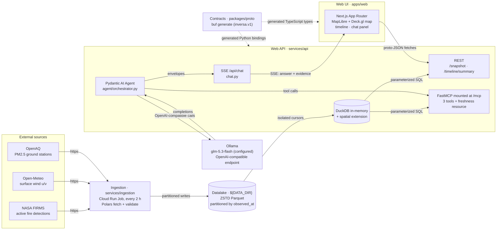

# Architecture

Inversa turns three live data feeds — wildfire detections, surface wind, and ground-station air quality — into a natural-language, map-first view of how fires degrade downwind air quality, in real time and over a rolling 7-day window. This page tours the layers as they are actually wired in this codebase. It is descriptive, not contractual: [`specs/README.md`](../specs/README.md) remains the authoritative specification; this document explains how the specs turned into running pieces.

## Component map

## How the pieces talk

A scheduled tick (`Cloud Scheduler`, every 2 h) runs the ingestion job, which fetches the three sources and lands date-partitioned Parquet in `${DATA_DIR}`. Every REST request queries that lake directly through in-memory DuckDB — no load step, no database server. The three analytical tools exposed over MCP wrap the same DuckDB queries and return `McpToolEnvelope` payloads carrying `evidence_refs` (`fire_ids`, `station_ids`, `focus_timestamp`). The Pydantic AI agent calls those tools, streams its answer over SSE to the browser, and the UI highlights the cited fires and stations on the map and timeline. Everything crossing a process boundary is proto-JSON whose types are generated from `packages/proto`.

## Layers

### 1 · External sources

| Source | Feeds | Caveats made visible, never hidden |
| --- | --- | --- |
| [NASA FIRMS](https://firms.modaps.eosdis.nasa.gov/) | Active fire detections | ~3 h satellite latency is surfaced in the UI |
| [Open-Meteo](https://open-meteo.com/) | Surface wind (u/v) | Drives downwind geometry (`ST_Azimuth`) |
| [OpenAQ](https://openaq.org/) | PM₂.₅ ground stations | Stale (>2 h) and outlier records keep their `quality_flag` |

### 2 · Contracts — `packages/proto`

`buf`-managed `.proto` files under `inversa/v1/` are the single source of truth. `make proto` generates Python bindings into `packages/shared-schemas` and TypeScript types into `apps/web/src/generated`; there are no hand-written duplicates of telemetry or grounding types anywhere. The API serializes proto-JSON on the wire, so the browser consumes exactly the generated types.

### 3 · Ingestion — `services/ingestion`

A Cloud Run Job on the `inversa.ingestion` namespace, triggered every 2 h. Collectors (`fetch_firms.py`, `fetch_openaq.py`, `fetch_open_meteo.py`) fetch over `httpx` with retry, validation and quality flags are applied via Polars (`validate.py`), and `storage.py` writes ZSTD-compressed Parquet split into one file per observation date (`observed_at`) plus a run log. A historical backfill lives in `backfill.py` ([playbook](../playbooks/backfill.md)).

### 4 · Datalake — `${DATA_DIR}`

The lake is just files: `/mnt/data` on Cloud Run (GCS FUSE) or `./.local_datalake` locally. The date-per-directory layout is what lets consumers prune to exactly the partitions a query needs. No database engine exists at rest — the analytical engine is spun up per request in the API.

### 5 · Analytics & serving — `services/api` (REST)

FastAPI (`app.py`) serves `/snapshot` (ETag-cached) and `/timeline/summary` (`rest.py`) from an in-memory DuckDB instance with the `spatial` extension. Cursors are isolated per request, all SQL lives in [`db/queries/`](../services/api/src/inversa/api/db/queries/) and is parameterized (`$target_ts`, `$radius_km`). The downwind reasoning is pure DuckDB: `ST_Azimuth` and `ST_Distance_Spheroid` find which stations sit downwind of a fire, and `ASOF JOIN` pairs each with the wind vector at the closest prior timestamp.

### 6 · Grounded AI — `/mcp` + Pydantic AI agent

A FastMCP server is mounted inside the same FastAPI app at `/mcp`. Its three tools (`analyze_downwind_impact`, `get_station_timeseries`, `find_worst_air_quality_events`) query DuckDB directly and every response is an `McpToolEnvelope` with structured `evidence_refs`; a `resource://data/freshness` resource exposes lake freshness. The chat agent (`agent/orchestrator.py`) is a Pydantic AI `Agent` whose toolset *is* that MCP surface — not a separate codepath — and `/api/chat` (`chat.py`) streams the session to the browser over SSE. See the [Pydantic AI spotlight](#pydantic-ai-over-ollama-glm-53) below.

### 7 · Frontend — `apps/web`

Next.js App Router in strict TypeScript, importing generated types from `src/generated/inversa/v1` rather than re-declaring them. MapLibre GL with Deck.gl layers renders fires, stations, wind vectors, and focus-region outlines; a canvas timeline scrubs the 7-day window; the chat panel consumes the SSE stream and highlights evidence refs returned inside tool envelopes; quality-flagged stations are shown as the blind spots they are.

### 8 · Cloud infrastructure — `infra/`

Terraform provisions GCS, two Cloud Run services (`web_ui`, `web_api`), the ingestion Cloud Run Job, and the Cloud Scheduler tick. GitHub Actions builds and pushes images and applies Terraform; deploys do **not** trigger ingestion — the lake refreshes at the next scheduled tick.

## Tech spotlights — new to me

### DuckDB over partitioned Parquet

The classic shape of this system is a database server, an ETL job to load it, and indexes to maintain. Here the datalake is only Parquet files, and DuckDB scans them **in-process** — zero load step, zero extra service, and it works identically against `/mnt/data` in prod and `./.local_datalake` on a laptop. Because ingestion partitions by `observed_at`, a query for one hour reads one day's files and skips the rest of the lake (partition pruning). The `spatial` extension supplies `ST_Azimuth`/`ST_Distance_Spheroid` without anything like PostGIS, and one isolated cursor per request keeps concurrent dashboards from tripping over each other. See [`db/queries/`](../services/api/src/inversa/api/db/queries/) and [spec-03](../specs/README.md).

### Pydantic AI over Ollama (GLM 5.3)

Pydantic AI provides typed, validated tool-calling plus streaming for the chat agent. The model behind it is **GLM 5.3**, served by Ollama through its OpenAI-compatible endpoint — the API just points Pydantic AI's `OpenAIChatModel` at Ollama's `base_url`, so the identical code runs against a local Ollama instance and the cloud deployment. `glm-5.3-flash` is the *configured* model — `AGENT_MODEL=openai:glm-5.3-flash:cloud` in `Makefile` / deployment (pinned in PR #32), while the code default stays `openai:gpt-4o-mini`. The toolset is not bespoke: it wraps the exact FastMCP surface any MCP client would see, so everything the agent "knows" comes back through `McpToolEnvelope` payloads grounded in the same DuckDB data the UI queries — and the envelope's evidence refs are what let the map highlight the fires and stations the answer is based on.
